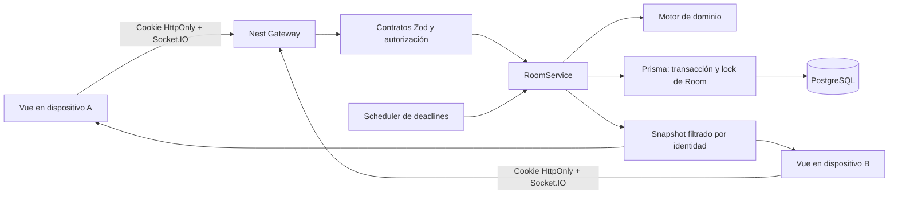

# Arquitectura y decisiones

## Paquetes

- `apps/web`: Vite/Vue 3/TypeScript, Router, Pinia, Socket.IO Client, Zod y GSAP. Componentes separados para lobby, sorteo, tablero, revisión y resultados; stores para sesión/partida y preferencias. Fonts Barlow Condensed e Inter empaquetadas localmente con fallback del sistema.
- `apps/server`: NestJS, gateway Socket.IO, autenticación, repositorio transaccional y servicios de salas, rondas, revisión y puntuación. El núcleo de reglas es TypeScript puro; Nest lo inyecta mediante factories para mantenerlo comprobable sin simular el framework.
- `packages/shared`: contratos Zod estrictos, catálogo de 48 categorías, tipos, normalización, comparación y scoring puro. Se compila antes de consumirlo desde ambos lados.

Los assets de referencia se conservaron durante el análisis de diseño. El frontend vive en `apps/web/src`, donde `apps/web/src/styles` contiene la única fuente de verdad de los tokens.

## Persistencia y atomicidad

`Room.state` es un agregado JSONB versionado, almacenado en PostgreSQL. Contiene configuración, roster, categorías ordenadas, estados, deadlines, bolsa de selectores, respuestas, dictámenes e historial. No existe una caché de juego en memoria que sea fuente de verdad. Dentro de la misma transacción se mantienen tablas relacionadas `Participant`, `ReservedSlot`, `Game`, `GameCategory`, `Round`, `Answer`, `AnswerVote`, `AnswerJudgment`, `RoundScore`, `Mutation` y `AuditEvent`. Los textos originales permanecen intactos después del cierre; una corrección de identidad vive en un campo separado.

Cada mutación adquiere `SELECT ... FOR UPDATE` parametrizado sobre la fila de Room y vuelve a leer el agregado. El lock serializa capacidad, STOP, BASTA, revisión y puntos entre sockets concurrentes; así una fase/revision leída previamente en el navegador no autoriza una escritura. El estado agregado y sus proyecciones normalizadas se escriben juntos o se revierten juntos. La migración añade índices únicos parciales para nombre/slot activos, unicidad por entidad/orden de categoría, voto y score, además de límites de capacidad/duración/puntos.

El JSONB evita reconstruir reglas competitivas a partir de relaciones incompletas al recuperarse. Las tablas normalizadas permiten auditoría y consultas. Es una decisión para una API de una instancia y salas pequeñas. Las escrituras de borradores comparan la entrada anterior y actual y actualizan solamente las entradas modificadas. El historial auditado conserva las transiciones intermedias aunque sean instantáneas (STARTING, ANSWERS_LOCKED, SCORING).

El anfitrión, selector, autor, votante, moderador y actor auditado tienen referencias a Participant. La FK del anfitrión es diferible hasta el commit para crear sala y miembro en la misma transacción. Triggers diferibles comprueban exactamente siete GameCategory. El motor verifica además roles y pertenencia; ningún ID actúa como credencial.

## Identidad y control de escritura

`GET /api/session` crea un token criptográfico de 32 bytes y una firma HMAC. La cookie `basta_session` es HttpOnly, Path=/, SameSite=Lax y Secure en producción. La BD guarda únicamente SHA-256 del token, una identidad UUID y expiración de siete días. El secreto debe tener al menos 32 caracteres. El token no se incluye en invitaciones ni en snapshots.

El gateway verifica la cookie al abrir el socket **y en cada comando**. Un miembro se identifica por su GuestIdentity, no por el nombre, código o socket.id. Una identidad no puede duplicarse dentro de la sala. La última pestaña que ejecuta resume obtiene el control; las otras reciben `writable: false` y sus escrituras se rechazan. Cuando se desconecta el escritor, otra conexión existente de la misma identidad puede recuperar el control. El estado de conexión dura mientras quede algún socket de ese participante.

Al iniciar Nest se marcan desconectados los miembros, porque los socket IDs del proceso anterior no son sesiones recuperables. El cliente vuelve a autenticar su cookie, reanuda y obtiene un snapshot. Una ausencia del anfitrión conserva sus privilegios por 30 segundos; después se transfieren al miembro conectado más antiguo (UUID como desempate determinista cuando coinciden timestamps). El selector desconectado dispone de 10 segundos de gracia. El sorteo siempre tiene timeout de 15 segundos.

## Contrato de red

Se usa un canal `command` con unión discriminada `type` para las acciones enumeradas en AGENTS, y un canal `room:snapshot` para reconciliación. Esta variación de nomenclatura mantiene una sola validación de payload/roles y reduce inconsistencias entre eventos parciales. `clock:ping` devuelve serverNow sin datos de sala; `room:error` comunica expulsión/salida.

ACK: `{ ok: true, data: Snapshot, revision }` o `{ ok: false, error: { code, message } }`. Las mutaciones se deduplican en PostgreSQL por `(roomId, guestId, clientMutationId)` y hash del comando; reutilizar un ID con otro payload se rechaza. La creación también tiene una clave única por identidad/ID. Los reintentos con el mismo ID retornan la proyección actual sin duplicar efectos. Los IDs nuevos aún deben cumplir fase/rol, de modo que dos STOP no cambian la letra ni dos publicaciones duplican puntos.

Los schemas `.strict()` rechazan participantId ajenos en borradores, letras, puntos no admitidos y estados falsificados. `review:award` recibe una solicitud explícita de 0/10/20 del moderador, pero el servidor vuelve a calcular y solo la acepta si cumple las reglas. No admite bonos ni puntajes arbitrarios.

Snapshots ocultan todos los textos/veredictos/votos ajenos durante el sorteo y ANSWERING. La única señal pública de progreso es el conteo por participante. Los eventos de guardado no incluyen textos. Las respuestas se revelan después de bloquear la ronda; el historial de rondas cerradas permanece visible a los miembros.

## Tiempo y recuperación

El scheduler inspecciona deadlines cada 250 ms. Cada comando y resume también comprueba el deadline antes de permitir una transición. Los timestamps absolutos de revelación (1,5 s), countdown (3 s), escritura y revisión se persisten; `advance` atraviesa determinísticamente deadlines vencidos. El scheduler acelera el cambio, pero no autoriza un input tardío.

El cliente estima el offset con serverNow y ping de ida/vuelta cada 15 segundos. El reloj se deriva de `endsAt`, no de descontar ticks. Una pestaña suspendida se coloca inmediatamente en la fase vigente al reanudar.

La pausa es una intervención explícita y auditada del anfitrión: congela la UI y, al reanudar, desplaza los deadlines por el tiempo pausado. Una desconexión, recarga o reinicio normal nunca amplía el plazo.

Una revisión que caduca determina mayorías y deja empates, apelaciones y ausencias de voto como DISPUTED; mantiene REVIEW sin deadline hasta una resolución explícita. Un reinicio no inventa dictámenes para poder publicar puntos.

## Borradores y conflictos

El navegador conserva borradores por GuestIdentity/código/roundId/categoryId, con timestamp, secuencia local y versión previa. El debounce de 300 ms sincroniza entradas del propietario. Los envíos por categoría se serializan y el ACK no pisa cambios locales realizados durante la petición. La versión de Answer proporciona compare-and-set frente a dos escrituras concurrentes.

Un conflicto conserva ambos textos y ofrece **Enviar mi versión** o **Usar versión del servidor**; nunca se sobrescribe silenciosamente. Solo se acepta una nueva escritura desde el socket autoritativo y dentro del deadline. `Terminé` y BASTA esperan que se confirmen los borradores pendientes. Fuera de plazo un borrador local no pasa a ser respuesta final retroactivamente.

## Catálogo, scoring y privacidad

El catálogo compartido es la fuente inicial y se siembra en PostgreSQL. Las desactivaciones de Category.enabled y aliases adicionales se cargan al iniciar la API; los aliases manuales por respuesta se registran en la revisión. La selección balanceada exige mínimo dos generales objetivas, dos específicas y siete categorías activas en total. IDs y orden se guardan desde el lobby, antes del inicio, y no cambian entre rondas.

La canonicalización solo usa aliases explícitos y nunca fuzzy matching. Se comprueba la inicial del texto original, descontando artículos, antes de decidir validez. Las repeticiones propias se determinan por columna izquierda antes de colisiones entre jugadores. El total acumulado se deriva de RoundScore, evitando incrementos repetidos. La puntuación es reproducible e idempotente.

La limpieza elimina salas caducadas y luego identidades vencidas sin miembros. Lobby: 24 horas desde actividad autorizada; resultados finales: siete días. Una partida abandonada conserva su plazo de expiración persistido; no se mantiene indefinidamente mediante pings. Los tiempos pueden configurarse mediante variables del servidor.

## Límites de esta versión

Una sola API, hasta siete humanos por sala, sin espectadores ni diccionario deportivo exhaustivo. La pertenencia deportiva requiere juicio humano. Redis y la coordinación entre réplicas no están implementados. Los comandos tienen límite de 16 KB, cada respuesta 80 caracteres, 400 comandos/minuto por identidad y 40 creaciones/joins/minuto por IP. El rate-limit reside en la instancia y se reinicia con ella; para exposición pública de gran escala conviene añadir límites persistentes en el reverse proxy.

La completitud operativa está pendiente de instalar dependencias y pasar integración/E2E con PostgreSQL. Este documento describe decisiones del código, no afirma que el despliegue se haya verificado.
